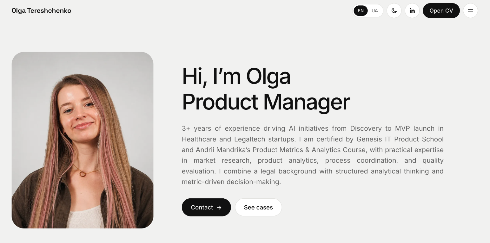

# Olga Tereshchenko — Portfolio

A bilingual, responsive portfolio for Product Manager. It is a static website built with HTML, CSS, and vanilla JavaScript.

The site includes a home page with experience, case studies, skills, speaking, certifications, and recommendations, plus individual case pages. English and Ukrainian content, theme switching, case filtering, image lightboxes, and the CV viewer are handled in the browser.

## Portfolio preview

## Main files

| File | Purpose |
|---|---|
| [`site/index.html`](site/index.html) | Page shell |
| [`site/js/app.js`](site/js/app.js) | Page rendering and interactions |
| [`site/js/data.js`](site/js/data.js) | Portfolio content and translations |
| [`site/css/styles.css`](site/css/styles.css) | Visual styles and responsive layouts |

## Documentation

| Doc | What it covers |
|---|---|
| [make-changes.md](docs/make-changes.md) | How to preview the portfolio, update its content, add a case, and check changes |
| [design-system.md](docs/design-system.md) | Colors, fonts, and layout styles used throughout the portfolio |

## Deploy

This is a static site. Configure GitHub Pages, Netlify, Vercel, or another static host to publish the `site/` directory as the site root; no compilation is needed. Before publishing, review the CV and other personal documents/images in `site/assets/` and only make publicly available materials that are intended to be shared.
